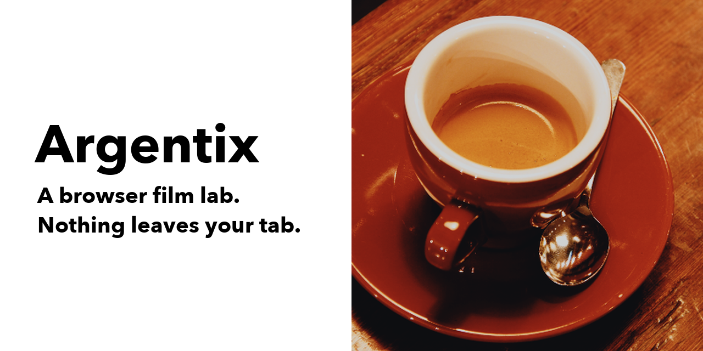
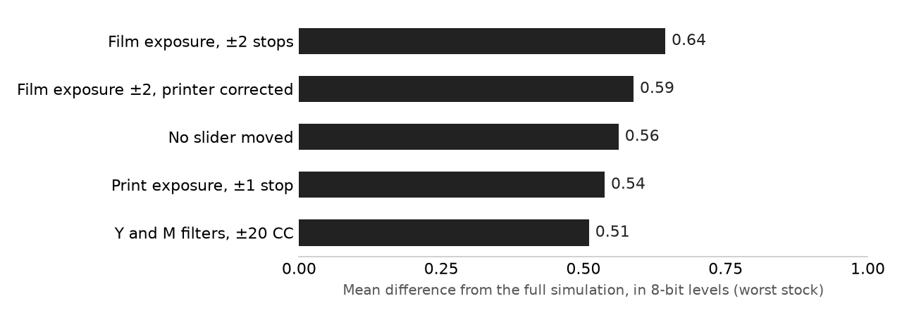

<h1 align="center">Argentix</h1>

<p align="center"><strong>A browser film lab: drop in a photo and see it on 20 film stocks and 8 print papers.</strong></p>

<p align="center">One static page. No account, no upload, no server.</p>

<p align="center"></p>

Film modeling powered by [spektrafilm](https://github.com/andreavolpato/spektrafilm) by Andrea Volpato.

## Install

| Where | How |
|---|---|
| Browser | Open <https://argentix.naklitechie.com> |
| Local | `python3 -m http.server 8742`, then open <http://127.0.0.1:8742> |

The page opens on a sample photo already developed. Choose a film, move the sliders, drop in your own photo and press Download. You need a browser with WebGL2 and float textures. Your photo stays in the tab.

## Why

Phone film filters are colour curves named after film. Your Portra filter has no idea what the paper did, how the negative responds when you overexpose it, or why grain shows most in the midtones.

spektrafilm simulates the real chain from light to dye, but it takes about a second per small image and needs Python. Argentix bakes that simulation into lookup tables offline, then runs the chain on your GPU, so every slider responds at once and no photo goes anywhere.

Scope today: 20 colour films, 8 papers, sRGB in and out. There are no black and white stocks, because spektrafilm has no profiles for them. Adjacency effects such as coupler diffusion are not modelled.

## Results



The chart shows 3 films across 12 test images. A wider check of all 132 film and paper combinations gives a worst mean difference of 0.97 of 255 levels ([docs/all-pairs-results.json](docs/all-pairs-results.json)). Reproduce with `scripts/inject_test.py`; the data is in [docs/slider-results.json](docs/slider-results.json).

## What the controls do

**Film** and **paper** choose the stock: 11 colour negatives, 5 cinema negatives and 4 slide films, each starting on the paper its profile names. Your paper choice then stays as you switch films.

**Film exposure** over- or underexposes the film, and the printer corrects brightness, as a lab would. You see contrast and colour change. **Print exposure** and the **yellow and magenta filters** are the enlarger's controls. Slide films are viewed directly, so they have no paper or print controls.

**Grain** is added to film density before printing, so the print's contrast shapes it as it does in a darkroom. **Halation** is the glow around bright areas. Both scale with the photo's size on a 35 mm frame.

## Commands

Every control is also a tool, called through `navigator.modelContext` where the browser has it and `window.argentix.tools` otherwise:

```text
get_state             read the stock, settings and credit line
list_stocks           list the films
list_papers           list the papers
set_stock             switch film
set_paper             switch paper
set_exposure          film exposure, -2 to 2 stops
set_print_exposure    print exposure, -1 to 1 stop
set_filters           yellow and magenta, -20 to 20 CC
set_grain             grain on or off
set_halation          halation on or off
reset                 settings back to default
load_photo            load a data URL or Blob
render_photo          full-size render as a data URL
download_photo        full-size render saved as a file
```

`window.argentix.manifest` lists the same entries with their input schemas.

## Verify it yourself

```bash
python -I scripts/inject_test.py out.json kodak_portra_400:kodak_portra_endura -- photos/*.png
python -I scripts/compare_browser.py browser.json assets/sample.png
python -I scripts/compare_effects.py browser2.json
```

The first compares tables with the per-pixel pipeline at each slider setting. The other two compare renders from the page itself, for tables, grain and halation. They need the spektrafilm environment described in [docs/2026-11-05-bake-findings.md](docs/2026-11-05-bake-findings.md). Measured results and limits are in [docs/2026-11-08-layout-findings.md](docs/2026-11-08-layout-findings.md).

## License

Code: © 2026 Chirag Patnaik, GPL-3.0, see `LICENSE`. Film tables: CC BY-SA 4.0, baked from spektrafilm profiles by Andrea Volpato and modified by re-encoding; each table file carries that notice. Asked, not required: no paid LUT packs, no commercial AI training on the tables, no "spektrafilm" in product branding. Sample photo: Rachel Michetti, CC0.

[Layout findings](docs/2026-11-08-layout-findings.md) · [first bake findings](docs/2026-11-05-bake-findings.md)
